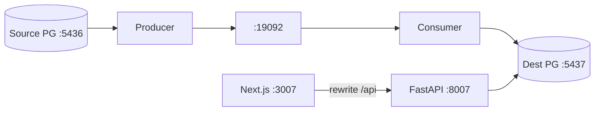

# RiverCDC — Change Data Capture Sync Platform

## Overview

RiverCDC streams PostgreSQL source mutations through Kafka to a destination database with idempotent apply, retries, dead-letter handling, replay, and a monitoring UI.

## Architecture

Yarn Workspaces + Turborepo monorepo. Python/FastAPI is used for CDC and the control-plane API (NestJS is intentionally not used here).

```
apps/
  web/         # Next.js dashboard (frontend only; /api proxied to FastAPI)
  api/         # FastAPI control plane
  producer/    # CDC producer runtime (logical decoding → Kafka)
  consumer/    # CDC consumer runtime (Kafka → destination apply)
infrastructure/
  docker-compose.yml   # source/dest Postgres, Kafka, Redis
  docker/
docs/
```



## Ports

| Service | Port |
| --- | --- |
| Next.js UI | 3007 |
| FastAPI | 8007 |
| Source Postgres | 5436 |
| Dest Postgres | 5437 |
| Kafka | 19092 |
| Redis | 6382 |

## Quick start

```bash
cd 03-cdc-sync-platform
cp apps/api/.env.example apps/api/.env
cp apps/web/.env.example apps/web/.env.local

yarn install
yarn python:install
yarn infra:up

yarn db:migrate
yarn db:seed

# terminals (or yarn dev for all):
yarn api:dev
yarn producer:dev
yarn consumer:dev
yarn web:dev
```

- UI: http://localhost:3007
- API docs: http://localhost:8007/docs

## Scripts

| Command | Purpose |
| --- | --- |
| `yarn infra:up` | Start Postgres, Kafka, Redis |
| `yarn python:install` | Create API venv + install deps |
| `yarn db:migrate` / `yarn db:seed` | Control-plane schema + seed |
| `yarn dev` | Web + API + producer + consumer |
| `yarn test` | API unit/integration tests |
| `yarn build` | Build workspaces (web Next.js) |
| `yarn lint` / `yarn typecheck` | Frontend quality gates |

## Package manager

**Yarn only** (`yarn.lock`). Do not use npm or pnpm for this repo.
