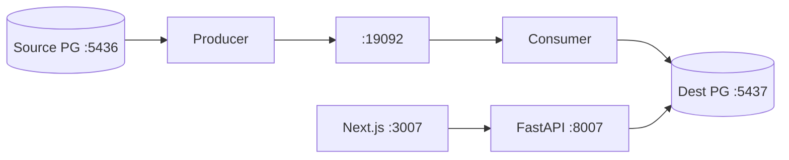

# RiverCDC — Change Data Capture Sync Platform

## Overview

RiverCDC streams PostgreSQL source mutations through Kafka to a destination database with idempotent apply, retries, dead-letter handling, replay, and a monitoring UI.

## Problem Statement

Teams need reliable near-real-time replication without paid CDC SaaS. This portfolio project demonstrates event-driven architecture, logical decoding, ordering, idempotency, and failure recovery on free local tooling.

## Goals

- Capture INSERT / UPDATE / DELETE from PostgreSQL
- Publish typed change events to Kafka
- Apply to a destination mirror with idempotency keys
- Control plane API + Next.js dashboard (pipelines, events, DLQ, lag)
- Free/local only

## Key Features

- Logical replication CDC via PostgreSQL `test_decoding` (custom Python producer)
- Kafka (KRaft) change stream + DLQ topic
- Consumer with retry → DLQ → replay APIs
- JWT auth (ADMIN / OPERATOR / VIEWER)
- Event log and sync lag monitoring

## Architecture Choice

**Custom Python CDC** using `pg_logical_slot_get_changes` + `test_decoding` → Kafka → Python consumer.

Not Debezium: lighter local footprint, explicit event schema / idempotency / DLQ control plane, still real logical decoding (not trigger polling).



## Ports

| Service | Port |
| --- | --- |
| Next.js UI | 3007 |
| FastAPI | 8007 |
| Source Postgres | 5436 |
| Dest Postgres | 5437 |
| Kafka | 19092 |
| Redis (optional) | 6382 |

## Quick start

```bash
cd 03-cdc-sync-platform
cp backend/.env.example backend/.env
cp frontend/.env.example frontend/.env.local

docker compose up -d

cd backend
python3 -m venv .venv
source .venv/bin/activate
pip install -r requirements.txt
python scripts/migrate.py
python scripts/seed.py

# terminals:
uvicorn app.main:app --host 0.0.0.0 --port 8007 --app-dir .
python -m app.cdc.producer
python -m app.cdc.consumer

cd ../frontend
npm install
npm run dev
```

- UI: http://localhost:3007  
- API docs: http://localhost:8007/docs  
- Demo login: `admin@rivercdc.local` / `Password123!`

## Demo: prove CDC

```bash
# With producer + consumer running:
docker exec -i rivercdc_source_pg psql -U rivercdc -d rivercdc_source -c \
  "INSERT INTO shop.orders (id, customer_email, amount_cents, status)
   VALUES (gen_random_uuid(), 'demo@rivercdc.local', 5000, 'pending');"

docker exec -i rivercdc_dest_pg psql -U rivercdc -d rivercdc_dest -c \
  "SELECT * FROM shop.orders ORDER BY updated_at DESC LIMIT 5;"
```

## Tests

```bash
cd backend && source .venv/bin/activate
pytest tests/unit -q
pytest tests/integration -q

cd ../frontend
npm run lint
npm run typecheck
npm run build
npm run test:e2e
```

## Database safety

Scripts and Compose only create/use databases named `rivercdc_*`. Never drop unknown databases.

## Docs

See `docs/` for PRD, architecture, API, security, testing, deployment, and `docs/completion-report.md`.

## Known limitations

- Single-table demo (`shop.orders`); UPDATE before-image limited under `test_decoding`
- At-least-once delivery; exactly-once via idempotent destination writes
- Single Kafka partition for ordering simplicity
- Local HTTP only (no managed TLS)
