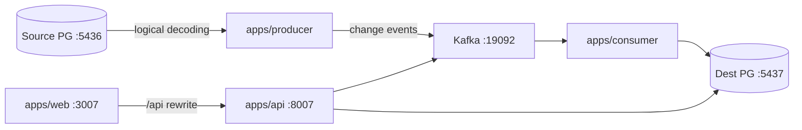

# RiverCDC — Architecture

## Monorepo layout

```
03-cdc-sync-platform/
├── apps/
│   ├── web/          # Next.js + React (frontend only)
│   ├── api/          # FastAPI control plane
│   ├── producer/     # Independent CDC producer runtime
│   └── consumer/     # Independent CDC consumer runtime
├── packages/         # Reserved; SQL migrations live under apps/api (no Prisma)
├── infrastructure/   # Docker Compose: source/dest Postgres, Kafka, Redis
├── docs/
├── package.json      # Yarn Workspaces root
├── yarn.lock
└── turbo.json
```

Producer and consumer are separate deployable runtimes under `apps/`. Shared Python modules live in `apps/api/app/` (config, DB, CDC helpers) so event schema and control-plane access stay consistent without nesting workers inside the API process.

## High-Level



## Components

### Source PostgreSQL
- `wal_level=logical`, publication `rivercdc_pub`
- Sample schema `shop.orders`
- Replication slot `rivercdc_slot` consumed by producer

### CDC Producer (`apps/producer`)
- Connects with replication protocol
- Decodes `test_decoding` messages → normalized `ChangeEvent`
- Publishes to Kafka topic `rivercdc.shop.orders`
- Updates producer offset / lag metrics in control plane

### Kafka
- KRaft single-node broker
- Topics: change stream + DLQ topic `rivercdc.dlq`

### CDC Consumer (`apps/consumer`)
- Reads Kafka messages
- Applies INSERT/UPDATE/DELETE to destination mirror
- Idempotency via `(pipeline_id, idempotency_key)` unique constraint
- On failure: retry → DLQ table + optional DLQ topic
- Updates sync state / consumed offsets

### FastAPI Control Plane (`apps/api`)
- Auth, pipelines, events, DLQ, lag, replay
- Reads/writes control tables on dest Postgres
- Why FastAPI: CDC decoding, Kafka clients, and data-plane tooling are stronger in Python for this project than NestJS

### Next.js UI (`apps/web`)
- Login, dashboard (lag), pipelines, events, DLQ actions
- Same-origin `/api/*` rewrite to FastAPI — no Next.js Route Handlers as backend

## Event Schema

```json
{
  "event_id": "uuid",
  "idempotency_key": "pipeline:table:pk:lsn:op",
  "pipeline_id": "uuid",
  "source": { "database": "rivercdc_source", "schema": "shop", "table": "orders" },
  "op": "c|u|d",
  "before": {},
  "after": {},
  "lsn": "0/16B3748",
  "ts_ms": 1710000000000
}
```

## Ordering & Idempotency

- Single-partition topic preserves LSN order per table stream
- Consumer commits Kafka offset only after successful apply (or DLQ write)
- Duplicate events skipped when idempotency key already applied

## Failure Recovery

1. Transient apply error → exponential backoff retry (in-process + redelivery)
2. Exhausted retries → DLQ row; consumer continues
3. Operator replay → re-publish to main topic or direct apply
4. Producer crash → resumes from replication slot LSN

## Why not Debezium?

Debezium + Kafka Connect is valid but heavier for a local portfolio stack (extra Connect worker, connector configs, image versions). Custom Python decoding keeps the learning surface on event schema, idempotency, DLQ, and control plane while still using real PostgreSQL logical replication.

## Why not NestJS?

This project’s core value is CDC / event processing. FastAPI + Python Kafka/Postgres clients are the justified backend choice. NestJS remains the TypeScript portfolio default elsewhere.
